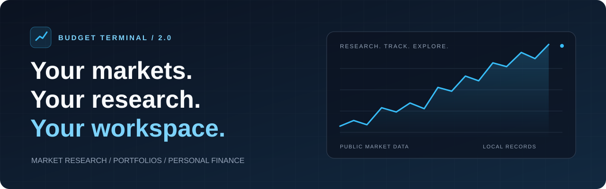
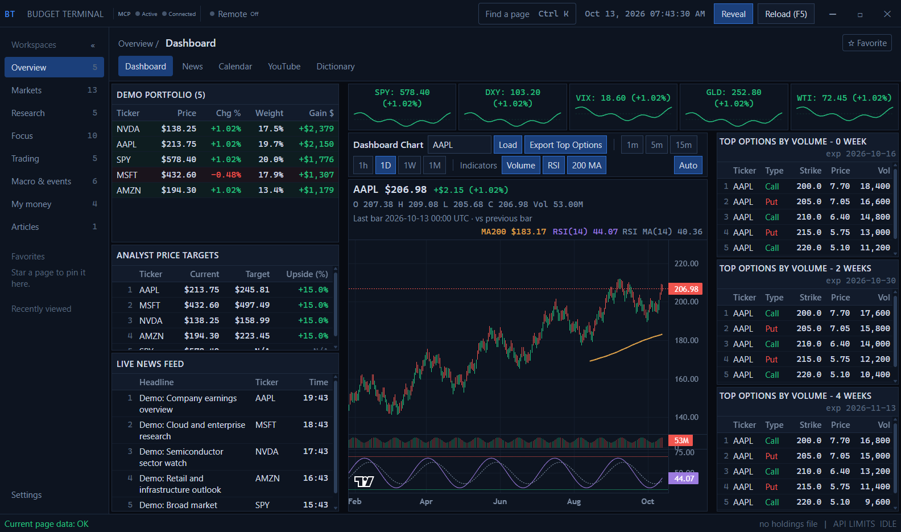
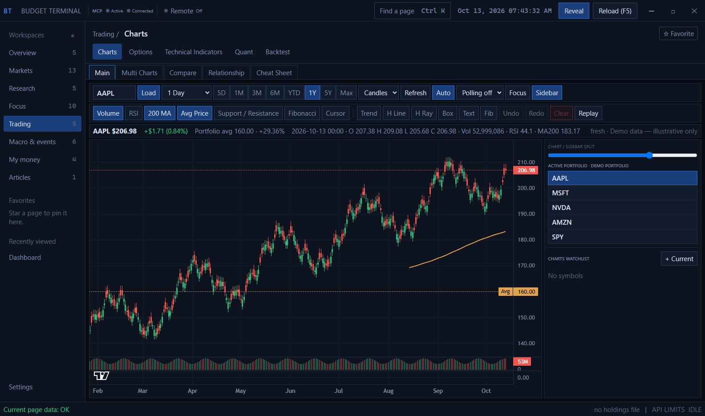
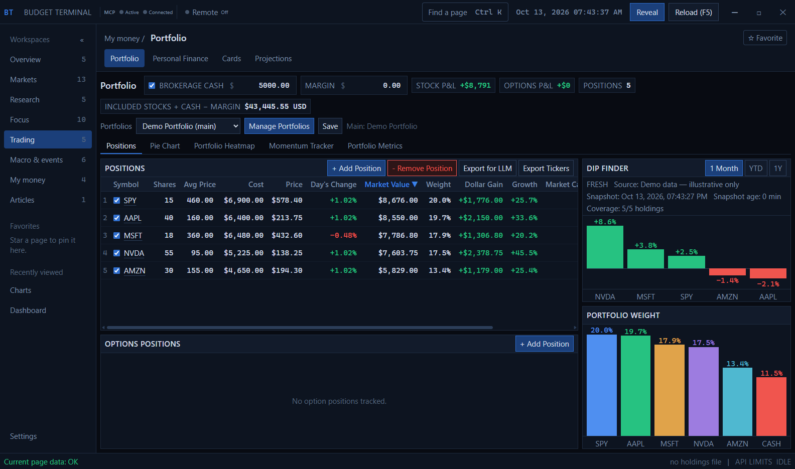

<p align="center">
  
</p>

<h1 align="center">Budget Terminal 2.0</h1>

<p align="center">
  <strong>A desktop workspace for market research, portfolio tracking, and personal finance.</strong><br>
  Explore markets, follow companies, and keep your financial records together.
</p>

<p align="center">
  
  
  
  
</p>

<p align="center">
  <a href="#quick-start">Quick start</a> ·
  <a href="#screenshots">Screenshots</a> ·
  <a href="#explore-the-workspaces">Workspaces</a> ·
  <a href="#documentation">Documentation</a> ·
  <a href="https://github.com/Wong-Zhen-Yi/Budget-Terminal-2.0/issues">Report an issue</a>
</p>

---

## One workspace, from research to records

Budget Terminal brings public market data and your saved financial records into an
Electron app built with React and TypeScript. Move from a market overview to company
fundamentals, charts, options, and valuation while carrying the same ticker between
research pages.

| | What you can do |
| :--- | :--- |
| **🌍 Follow the markets** | Explore heatmaps, ETFs, forex, crypto, commodities, news, and economic events. |
| **🔎 Research companies** | Review fundamentals, valuation, institutional activity, [DefeatBeta Terminal](docs/defeatbeta-terminal.md), and focused company and semiconductor pages. |
| **🌐 Browse the sources** | Use the embedded [Browser](docs/browser.md) with shared Chromium tabs, source text reading, and agent research access enabled by default with Disable and Stop controls. Login profiles stay outside source/Git, with ignore rules and commit/push checks against accidental publication. |
| **📈 Study price action** | Work with charts, technical indicators, options chains, quantitative tools, and backtests. |
| **💼 Track your money** | Manage portfolios, personal finance, Cards, and projections with local saved records and backups. |
| **⚡ Open ready pages** | Every implemented page starts loading at launch, with startup progress and failures visible. |
| **🔗 Extend your workspace** | Connect local research tools through MCP while keeping the workspace in the desktop app. |

## Screenshots

Screenshots of the current app using an isolated demo profile. Holdings, prices,
headlines, and indicator values are illustrative sample data.

### Dashboard

Market snapshots, portfolio holdings, price action, analyst targets, and options
in one workspace.



<details>
<summary><strong>Charts — price action and technical tools</strong></summary>

Candlestick history, volume, moving averages, drawing tools, and portfolio context.



</details>

<details>
<summary><strong>Portfolio — positions and allocation</strong></summary>

Position values, gains, portfolio weights, and performance snapshots.



</details>

## Quick start

### 1. Get the source

```bash
git clone https://github.com/Wong-Zhen-Yi/Budget-Terminal-2.0.git
cd Budget-Terminal-2.0
```

### 2. Install and launch

Use **Node.js 24 LTS and npm 11** for a new installation. Supported versions are
Node.js **22.23.4+, 24.22.1+, or 26.12.1+**, with **npm 10.9.8+**, as defined in
[package.json](package.json).

```bash
npm install
npm run dev
```

Prefer a launcher? Open the file for your operating system from the checkout:

| Windows | macOS | Linux |
| :--- | :--- | :--- |
| [Launch Budget Terminal.cmd](Launch%20Budget%20Terminal.cmd) | [Launch Budget Terminal.command](Launch%20Budget%20Terminal.command) | [Launch Budget Terminal.sh](Launch%20Budget%20Terminal.sh) |

Each launcher checks the runtime, installs dependencies, verifies Electron, builds
the latest source, and opens the production app. Keep its terminal open while using
Budget Terminal. Build or startup errors stay visible in the launcher window.

On Windows, the double-click launcher finds a supported Node.js installation even
when an older version comes first on PATH. If none is available, it downloads
Node.js 24.22.1 from nodejs.org, checks the pinned SHA-256 checksum, and installs it
under `%LOCALAPPDATA%\BudgetTerminal\runtimes`. This needs no administrator access
and keeps the runtime outside the checkout. Internet access is required for the
first download; subsequent launches reuse it. On Windows, the root `npm run dev`
command uses this same runtime recovery, even if your shell has an older Node.js.
Other command-line `npm` commands still use the Node.js installation configured in
your shell.

For live code updates on Windows, double-click
[Launch Budget Terminal Live.cmd](Launch%20Budget%20Terminal%20Live.cmd) or run
`npm run dev` from the repository root. Close any existing Budget Terminal window
first (the app allows only one running instance). Live mode checks dependencies,
verifies Electron and builds MCP tools before starting `electron-vite dev --watch`.
UI edits update automatically; Electron main/preload edits trigger rebuilds and
restarts or reloads. Keep the terminal open. The normal launcher still builds and
opens a fixed production snapshot; it does not watch source changes.

These Node minimums include the October 2026 eMudhra certificate compromise fix.
Electron **45.1.0** includes the corresponding native SPKI blocklist for
both Node TLS (including Yahoo workers) and Chromium research tabs. Electron's
embedded Node version is separate from the system Node installation; keep both
runtimes patched and fully restart the app after updating. Startup rejects
certificate-verification bypasses, and the launcher forces npm certificate checks.
See the [certificate security notes](docs/certificate-security.md) for verification
and guidance for separate Python environments.

On Steam Deck, use Desktop Mode and run `npm run setup:linux` once to add Budget
Terminal to the application menu. The launcher finds Node in `~/.local/bin` even
when opened from Dolphin. It builds the latest source on each launch, and the
window fits the display's available work area, including the Deck's 1280×800 screen.
For Gaming Mode, add Budget Terminal from the application menu as a non-Steam game
and leave Proton compatibility disabled. A keyboard and mouse or Steam Input's
trackpad mouse controls are useful for the research tables. No SteamOS system
partition changes are required. All implemented pages still load at startup.

The launcher also checks Codex for the **Agents** page and passes the detected
executable to the app. It detects the Windows Codex desktop installation, native
CLI installations and native executables behind Windows npm shims. If Codex is
missing, the app still opens with setup instructions in Agents. The launcher
does not sign in or start agent work; autonomous mode remains off by default.

<details>
<summary><strong>Electron repair and production bundles</strong></summary>

Installation verifies Electron automatically. If its download was interrupted, run:

```bash
npm run ensure:electron
```

To build and preview the desktop bundles:

```bash
npm run build
npm run preview --workspace budget-terminal-desktop
```

The build produces application bundles. Installer packaging and automatic
application updates are not configured.

</details>

## Explore the workspaces

The current navigation includes **57 implemented pages**, including Settings.

| Workspace | Pages |
| :--- | :--- |
| **Overview** | Dashboard, News, Calendar, YouTube, Dictionary |
| **Markets** | Pre-Market, Heatmap, Up/Down, Trading Volumes, Beta, Market Cap, Price, ETF, S&P500, Forex, Crypto, Gold, Oil |
| **Research** | Stocks, Discovery, Fundamentals, Scorecard, Valuation, Institutions |
| **Focus** | BMNR, Bitcoin, HOOD, HIMS, SOFI, MU, AMZN, AVGO, Semiconductors, VST |
| **Trading** | Charts, Options, Technical Indicators, Quant, Backtest |
| **Macro & events** | Global, Economic, Bonds, Money, IPO, Politics |
| **My money** | Portfolio, Personal Finance, Cards, Projections |
| **Articles** | Articles |
| **Notifications** | Notifications |
| **Settings** | Settings |

**Crypto** includes a **Hyperliquid Perpetuals** table with mark prices, 24-hour
changes, hourly funding rates, USD open interest, and 24-hour volume. It uses the
free public market-data API without an API key or wallet, loads at startup, and
shares the equity WebSocket for live updates, with REST fallback when unavailable.
Other Crypto feeds refresh every 60 seconds while the page is visible. Sort columns to explore the
active markets. Hyperliquid failures appear in page readiness and panel warnings;
the other crypto feeds remain available. These are venue-specific perpetual
contracts, displayed separately from spot quotes. No trading actions are exposed.

Mapped crypto-equity proxies use the shared perpetual mark directly. Yahoo stock
volume and market cap have an independent 15-minute cache; manual Refresh reloads
that metadata. CoinGecko spot quotes remain primary. If a coin's spot price is
unavailable, a labelled Hyperliquid perpetual can supply price and venue volume
before trying Yahoo, without inventing a global market cap.

**Stock quotes and charts** prefer explicitly mapped Hyperliquid equity perpetuals.
These USD **mark prices** also value portfolio positions, gains and allocations.
Their percentage changes use a rolling **24-hour** basis. One shared WebSocket
streams marks and actual venue candles; reconnects restore subscriptions. Stock
and chart views identify the price and candle sources separately. Source labels
and PERP badges distinguish these derivative marks from stock-exchange prices.
Market Cap, Price, Heatmap and Crypto equity-proxy displays share these marks.
Screen candidates and historical-return metrics remain Yahoo stock data; the Price
screen filters its returned candidates against the selected displayed marks.

Yahoo remains the source for fundamentals, unsupported symbols, adjusted return
analytics and longer stock histories. A chart switches as a complete series when
Hyperliquid cannot cover the requested range or its 5,000-candle window; it never
joins stock candles to perp candles. Indicators use the chart's instrument.
Quote outages use labelled Yahoo fallbacks and remain visible in data readiness.
The reviewed market mappings are in `apps/desktop/electron/shared/equityMarkets.ts`;
SOFI and VST use `para` markets and most other mapped stocks use `xyz`.
Run `npm run probe:hyperliquid` for deterministic checks, or append `-- --live`
to verify prices, candles and WebSocket updates against the public API.

Charts for tickers in every portfolio preload at startup and stay cached while the
app runs. This covers Stocks and the selected Dashboard, Main and Multi chart views.
New holdings and changes to chart intervals or ranges prepare those views automatically.
Background refresh continues across pages and unfocused windows. The footer shows
portfolio chart readiness; refresh failures retain the last usable chart and appear
in the footer and Settings.

MCP and embedded Agents use the same Hyperliquid routing. `budget_terminal_quotes`
refreshes current prices, prefers the shared live stream, and skips macro quotes
and sector lookups by default. Request `includeMacro: true` or `includeSectors: true`
to include them. Compact, projected and paginated responses retain instrument,
currency, price/change basis and fallback labels in `response.provenance`.

Star pages to pin Favorites. Use **Ctrl+K** or **backtick** to open page search;
recent pages appear first. Settings controls page visibility, ordering, favorites,
privacy, and the market clock.

**Notifications** is the shared local inbox for Agent alerts, market openings,
and tests. Existing Agent alerts migrate automatically. Use **Send test notification**
to check desktop delivery. Windows notification settings and Do not disturb control
whether banners appear; delivery failures remain visible in the inbox.

The page offers **Enable market-open reminder** for a desktop alert at the regular
U.S. equity opening, 9:30 AM New York time. The next alert is displayed in Singapore
time, with daylight saving adjustments, weekends, and scheduled exchange holidays
handled automatically. The setting survives relaunch; old missed openings are
skipped. Keep the app open for delivery.

The Research bar transfers a ticker to Stocks, Fundamentals, Charts, Options, or
Valuation. Clicking a portfolio ticker opens Stocks; options handoffs open a
single-expiration chain. Hidden pages remain hidden.

**Scorecard** compares 3–6 companies with selectable, sortable financial and
valuation columns and a metric comparison chart. Save named comparisons locally,
then restore their tickers, columns, and chart metric. Annual metrics show each
company's fiscal year end; financial amounts use Fundamentals' USD normalization.
Source details retain freshness, currency conversions, and partial-data warnings.
The current comparison loads at startup, including when Scorecard is unvisited.

## Your data and your workspace

- **Local records and backups.** Financial records are saved outside the checkout.
  Settings provides JSON export/import, and saved changes update an automatic
  backup in Downloads. See [storage and backup details](docs/user-guide.md#saved-data-and-backups).
- **Visible data quality.** Supported panels show source, freshness, coverage, and
  partial-data issues. Public feeds can vary in availability; cached results keep
  their limitations visible. See [startup and data freshness](docs/user-guide.md#startup-and-data-freshness).
- **Desktop-only workspace.** Open Budget Terminal in Electron. Remote browser
  access, pairing, and the built-in web server are no longer included.
- **Local MCP tools.** Connect research and saved-record tools to supported local
  clients. Write tools edit local records, not broker orders. See the [MCP setup guide](docs/local-mcp.md).

## Documentation

- [Market data provider policy](docs/defeatbeta-backup.md) — Yahoo Finance market data, explicit source failures, and the dedicated DefeatBeta research page.
- [DefeatBeta Terminal](docs/defeatbeta-terminal.md) — ten research tabs, published datasets, startup loading, and valuation assumptions.

| Guide | What's inside |
| :--- | :--- |
| [Data, startup & backups](docs/user-guide.md) | All-page readiness, feed health, saved-data locations, migration, and backup behavior. |
| [Local MCP](docs/local-mcp.md) | Client registration, research tools, record edits, screenshots, and bridge security. |
| [Development](docs/development.md) | Architecture, verification commands, security checks, and data-layer conventions. |
| [Semiconductors](docs/semiconductors.md) | Semiconductor supply-chain research and data sources. |
| [Chart pattern reference](apps/desktop/docs/chart-patterns/README.md) | Pattern examples and chart reference images. |

## Contributing

Bug reports and focused improvements are welcome. When reporting an issue, include
your operating system, runtime versions, steps to reproduce, and relevant errors.

For code changes, follow [the repository guidelines](AGENTS.md), run TypeScript and
the relevant probes, and smoke-test visible changes:

```bash
npm run typecheck
npm run probe:charts -- --offline
```

See the [development guide](docs/development.md#verification) for additional checks.
`@tanstack/react-virtual` remains pinned to **3.13.12**: version 3.14.24 fails
the 10,000-row table sorting check. Run `probe:performance-ui` in the desktop
workspace before changing that pin.
Keep credentials, personal financial records, and generated bundles out of commits.

---

<p align="center">
  <strong>Budget Terminal 2.0</strong><br>
  Markets, research, and personal finance in one desktop workspace.
</p>
