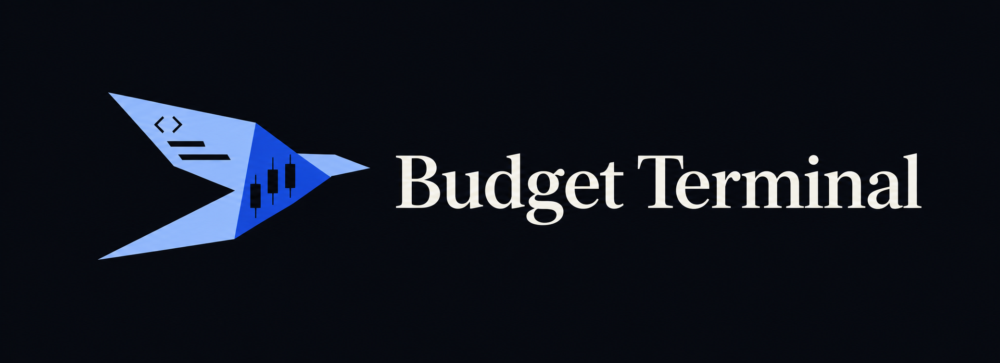
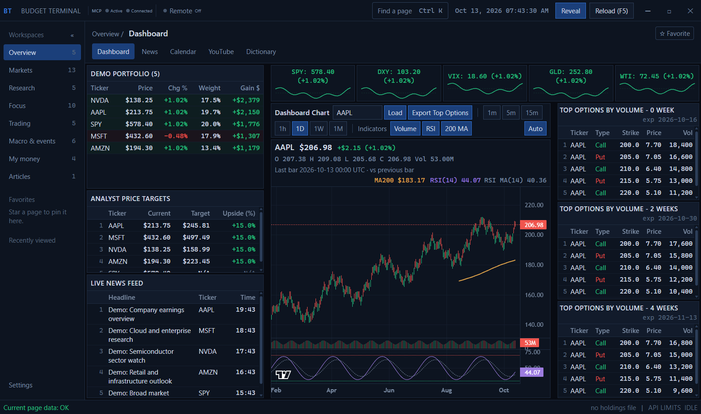
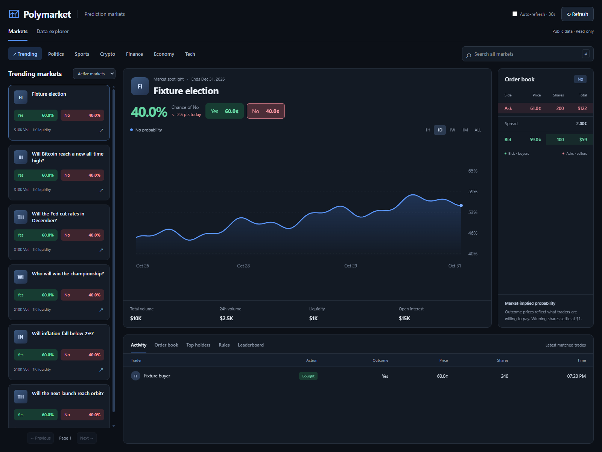
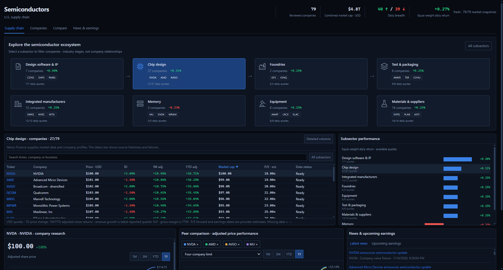
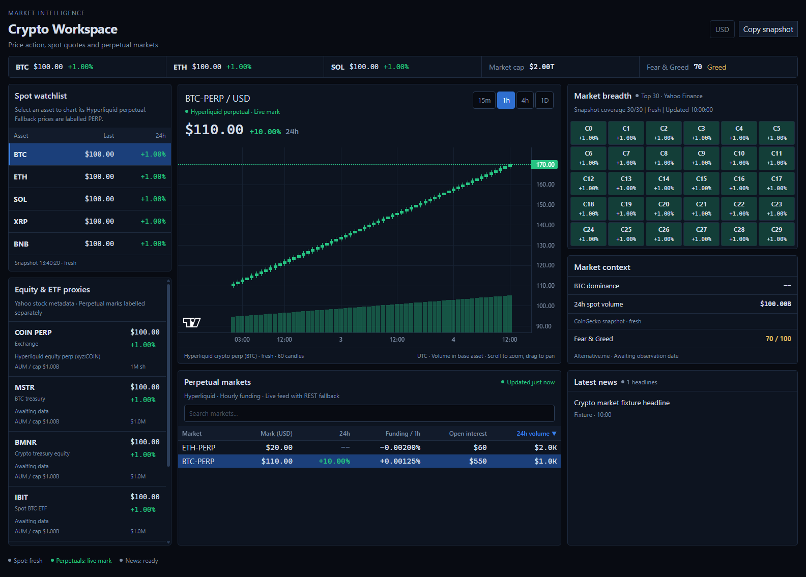
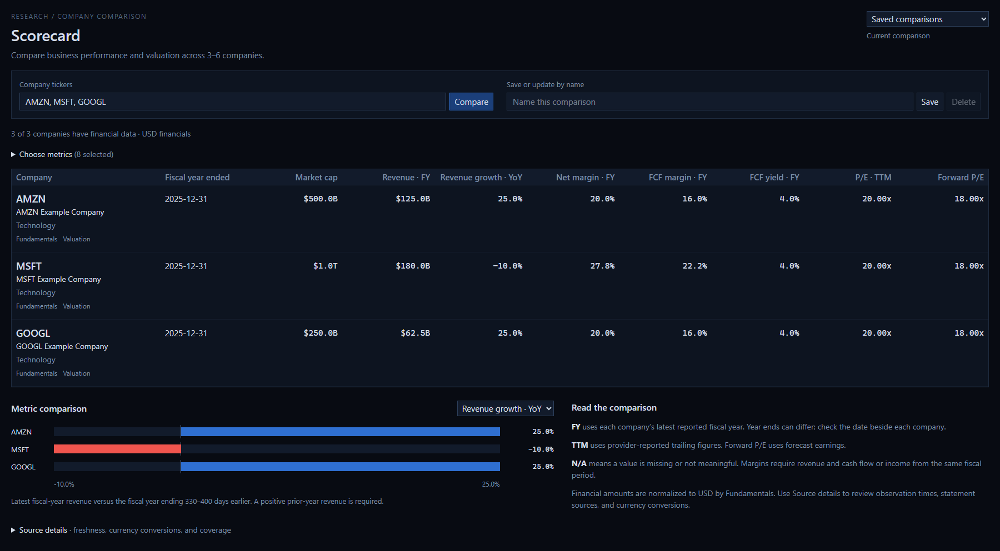
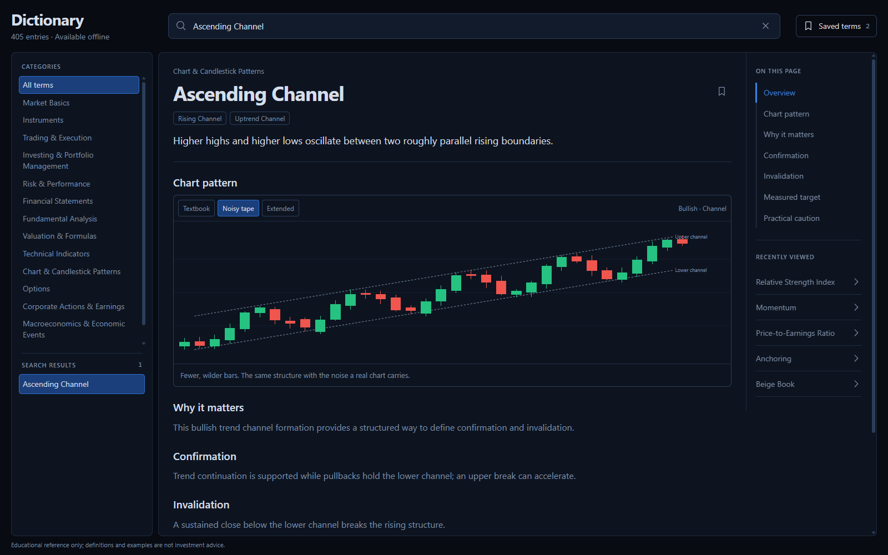
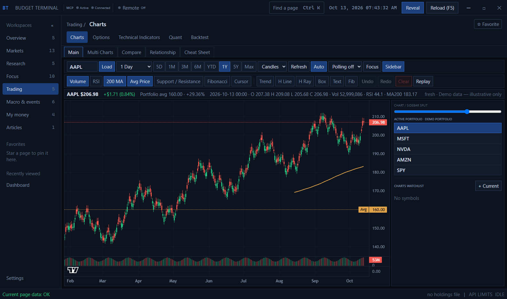
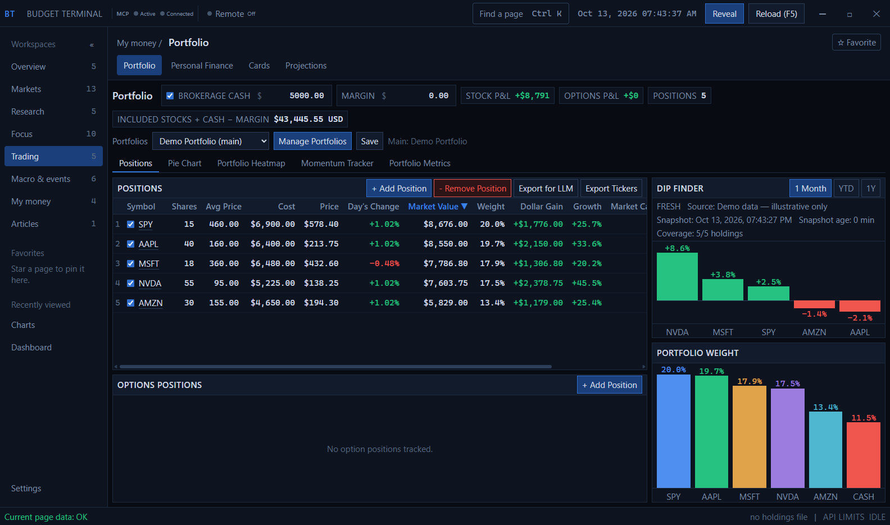

<p align="center">
  
</p>

<h1 align="center">Budget Terminal 2.0</h1>

<p align="center">
  <strong>A desktop workspace for market research, portfolio tracking, and personal finance.</strong><br>
  Explore markets, follow companies, and keep your financial records together.
</p>

<p align="center">
  
  
  
  
</p>

<p align="center">
  <a href="#quick-start">Quick start</a> ·
  <a href="#screenshots">Screenshots</a> ·
  <a href="#explore-the-workspaces">Workspaces</a> ·
  <a href="#documentation">Documentation</a> ·
  <a href="https://github.com/Wong-Zhen-Yi/Budget-Terminal-2.0/issues">Report an issue</a>
</p>

---

## One workspace, from research to records

On Windows, double-click **Launch Budget Terminal.cmd** to open the desktop app
directly. It checks and updates the app automatically. You can also type `btd` in a new terminal.
See [Quick start](#quick-start).

Budget Terminal brings public market data and your saved financial records into an
Electron app built with React and TypeScript. Move from a market overview to company
fundamentals, charts, options, and valuation while carrying the same ticker between
research pages.

| | What you can do |
| :--- | :--- |
| **🌍 Follow the markets** | Explore heatmaps, ETFs, forex, crypto, commodities, news, and economic events. |
| **🔎 Research companies** | Review fundamentals, valuation, institutional activity, [DefeatBeta Terminal](docs/defeatbeta-terminal.md), and focused company and semiconductor pages. |
| **🌐 Browse the sources** | Use the embedded [Browser](docs/browser.md) with shared Chromium tabs, source text reading, and agent research access enabled by default with Disable and Stop controls. Login profiles stay outside source/Git, with ignore rules and commit/push checks against accidental publication. |
| **📈 Study price action** | Work with charts, technical indicators, options chains, quantitative tools, and backtests. |
| **Explore prediction markets** | Search Polymarket events and inspect outcome probabilities, price history, order-book depth, and activity through public read-only data. |
| **💼 Track your money** | Manage portfolios, personal finance, Cards, and projections with local saved records and backups. |
| **⚡ Open ready pages** | Every implemented page starts loading at launch. Startup progress, failures, and diagnostic logs stay in Settings. |
| **Saved pages at launch** | Use cached content while every page refreshes. Settings controls separate page, market-data and image budgets, retention and cache diagnostics. |
| **🔗 Extend your workspace** | Connect local research tools through MCP while keeping the workspace in the desktop app. |
| **Work with Agents** | Use the embedded Codex workspace for research and local alerts, with autonomous mode off by default. |

## Screenshots

Explore eight views across markets, research, charting, portfolios, and learning.
The captures use isolated demo profiles or isolated page components with synthetic
fixtures. Holdings, prices, probabilities, headlines, and indicator values are
illustrative sample data, not live quotes or personal records. See
[capture details](docs/assets/screenshots/README.md).

### Dashboard

Market snapshots, portfolio holdings, price action, analyst targets, and options
in one workspace.



### Polymarket — prediction market research

Discover events and inspect outcome probabilities, price history, order-book depth,
and market activity in a read-only workspace.



<details>
<summary><strong>Semiconductors — supply chain and sector research</strong></summary>

Explore industry stages, filter companies by subsector, compare performance, and
follow company research and earnings context.



</details>

<details>
<summary><strong>Crypto — spot watchlist, perpetual charts, and market breadth</strong></summary>

Keep spot quotes, a candlestick and volume chart, equity proxies, market breadth,
and venue-specific perpetual funding and open interest together.



</details>

<details>
<summary><strong>Scorecard — compare companies and valuation metrics</strong></summary>

Compare annual financials, margins, valuation multiples, and signed revenue growth
across companies. Choose metrics and save named comparisons locally.



</details>

<details>
<summary><strong>Dictionary — offline learning and illustrated chart patterns</strong></summary>

Search 405 offline entries, save terms, and study chart patterns with diagrams,
confirmation criteria, invalidation conditions, and a reading outline.



</details>

<details>
<summary><strong>Charts — price action and technical tools</strong></summary>

Candlestick history, volume, moving averages, drawing tools, and portfolio context.



</details>

<details>
<summary><strong>Portfolio — positions and allocation</strong></summary>

Position values, gains, portfolio weights, and performance snapshots.



</details>

## Quick start

### 1. Get the source

```bash
git clone https://github.com/Wong-Zhen-Yi/Budget-Terminal-2.0.git
cd Budget-Terminal-2.0
```

### 2. Install and check the setup

On Windows, double-click [Launch Budget Terminal.cmd](Launch%20Budget%20Terminal.cmd)
from the checkout. It installs or repairs a supported Node.js runtime, dependencies
and Electron, builds and checks the desktop app, and installs or updates the per-user
`btd` command. Dependency checks and build output appear in the launcher terminal,
then the desktop app opens directly. Keep that terminal open while using the app.
The launcher shows five numbered stages with completion times, live installation
and build output, and a final check result. Colours follow the app's accents;
redirected output and `NO_COLOR` use plain text.
Setup also removes the retired
`bt` command when it belongs to this checkout.
Every launch, including the first launch from a fresh checkout, runs `npm install`,
checks or repairs Electron, builds the app and verifies its files before opening it.
Failed dependency checks stop startup. There is no interface selection menu, and
`btd` uses the same dependency checks when launched from a terminal.
No administrator access is needed. Double-click it again whenever you need to open
the app. From the checkout, `npm.cmd run setup` runs the Windows checks without opening the app.

On macOS, install a supported Node.js version with npm, then double-click
[Launch Budget Terminal.command](Launch%20Budget%20Terminal.command) in Finder.
It checks the runtime, installs dependencies, builds the latest source and opens
the desktop app. Keep its Terminal window open while using the app. Homebrew,
Volta, fnm and nvm installation locations are checked automatically. Launch errors
stay visible so you can fix them and retry. Keep the launcher in the checkout;
you can create a Finder alias for convenient access elsewhere.

For a manual installation on any platform:

Use **Node.js 24 LTS and npm 11** for a new installation. Supported versions are
Node.js **22.23.4+, 24.22.1+, or 26.12.1+**, with **npm 10.9.8+**, as defined in
[package.json](package.json).

```bash
npm install
npm run dev
```

On Steam Deck, switch to **Desktop Mode** and install the desktop and application
menu shortcuts once from the checkout:

```bash
npm run setup:linux
```

Double-click **Budget Terminal 2.0** on the desktop, or run
[Launch Budget Terminal.sh](Launch%20Budget%20Terminal.sh) from the checkout.
The launcher checks the runtime, installs dependencies, builds the latest source,
and opens the desktop app. Keep its terminal open while using the app. It finds
Node in `~/.local/bin`, fnm's default alias, Volta, or a per-user Budget Terminal
runtime. Install a supported Node.js version first; no SteamOS system changes
or administrator access are required. Re-run `npm run setup:linux` after moving
the checkout. For Gaming Mode, add the application menu entry as a non-Steam game
and leave Proton compatibility disabled.

Steam Deck Desktop Mode opens the window within the display's usable area,
including panel offsets and desktop scaling. The window refits when docking,
undocking or changing resolution. Gaming Mode (Gamescope) opens in native
fullscreen. The title-bar restore button exits fullscreen.

Basic controller support works with standard gamepads while the desktop app has
focus. Use the D-pad or left stick to move focus, A/Cross to activate, B/Circle to
dismiss or leave a text field, LB/RB (L1/R1) to switch pages, Menu/Options to open
the page picker, and the right stick to scroll. Hold a direction to repeat.
Page switching follows the workspace order in the sidebar and the page buttons
within each workspace, including custom ordering and hidden pages. Steam Input
layouts that map the D-pad to keyboard arrows follow the same order.
Select fields use up/down to change and left/right to leave. Text entry and
embedded browser content still require a keyboard, touch or mouse. On Steam
Deck, select a **Gamepad** Steam Input layout to expose controller buttons;
desktop mouse layouts can still be used as usual. The control reference is in
Settings → Workspace → Keyboard Shortcuts → Controller controls.

### 3. Open Budget Terminal

After Windows setup, open a new PowerShell or Command Prompt window and type `btd`
for the desktop app.

Double-click launchers show dependency checks and build output in their terminal;
keep that terminal open while using the app. The Windows `btd` command runs
independently, so its calling terminal can close. Development mode requires its
terminal to stay open.

`btd` in a new PowerShell or Command Prompt window opens the desktop app from any
directory and checks dependencies and builds the latest desktop source before opening it.
To install or repair it manually on Windows, run `npm run setup:desktop` from the checkout.
Background `btd` startup logs are saved under `%LOCALAPPDATA%\BudgetTerminal\launcher-logs`.
Optional arguments include `btd -Dev`
for live updates and `btd -Logs` to open diagnostics. To remove only this command,
run `powershell.exe -NoProfile -ExecutionPolicy Bypass -File scripts/install-bt.ps1 -Uninstall`.

### Launch behavior and troubleshooting

On Windows, the app bypasses Chromium's GPU shader disk caches to avoid locked-file
and access-denied errors during startup or relaunch. GPU acceleration stays enabled;
shaders may need to compile again on each launch. Saved application data and Browser
login profiles are preserved, and existing cache files do not need to be deleted.

On Windows, the double-click launcher finds a supported Node.js installation even
when an older version comes first on PATH. If none is available, it downloads
Node.js 24.22.1 from nodejs.org, checks the pinned SHA-256 checksum, and installs it
under `%LOCALAPPDATA%\BudgetTerminal\runtimes`. This needs no administrator access
and keeps the runtime outside the checkout. Internet access is required for the
first download; subsequent launches reuse it. On Windows, the root `npm run dev`
command uses this same runtime recovery, even if your shell has an older Node.js.
Other command-line `npm` commands still use the Node.js installation configured in
your shell.

For the desktop app with live code updates, run
`npm run dev` from the repository root. Close any existing Budget Terminal window
first (the app allows only one running instance). Live mode checks dependencies,
verifies Electron and builds MCP tools before starting `electron-vite dev --watch`.
UI edits update automatically; Electron main/preload edits trigger rebuilds and
restarts or reloads. Keep the terminal open. Close and relaunch an existing production
window once to enable live updates. For a fixed production build, run
`node scripts/launch.cjs` instead.

These Node minimums include the October 2026 eMudhra certificate compromise fix.
Electron **45.1.0** includes the corresponding native SPKI blocklist for
both Node TLS (including Yahoo workers) and Chromium research tabs. Electron's
embedded Node version is separate from the system Node installation; keep both
runtimes patched and fully restart the app after updating. Startup rejects
certificate-verification bypasses, and the launcher forces npm certificate checks.
See the [certificate security notes](docs/certificate-security.md) for verification
and guidance for separate Python environments.

The launcher also checks Codex for the **Agents** page and passes the detected
executable to the app. It detects the Windows Codex desktop installation, native
CLI installations and native executables behind Windows npm shims. If Codex is
missing, the app still opens with setup instructions in Agents. The launcher
does not sign in or start agent work; autonomous mode remains off by default.

<details>
<summary><strong>Electron repair and production bundles</strong></summary>

Installation verifies Electron automatically. If its download was interrupted, run:

```bash
npm run ensure:electron
```

To build and preview the desktop bundles:

```bash
npm run build
npm run preview --workspace budget-terminal-desktop
```

The build produces application bundles. Installer packaging and automatic
application updates are not configured.

</details>

## Explore the workspaces

The current navigation includes **58 implemented pages**, including Settings.

| Workspace | Pages |
| :--- | :--- |
| **Overview** | Dashboard, Dashboard 2.0, News, Calendar, YouTube, Dictionary |
| **Markets** | Pre-Market, Heatmap, Up/Down, Trading Volumes, Beta, Market Cap, Price, ETF, S&P500, Forex, Crypto, Polymarket, Gold, Oil |
| **Research** | Browser, Stocks, Discovery, Fundamentals, Scorecard, DefeatBeta Terminal, Valuation, Institutions |
| **Focus** | BMNR, Bitcoin, PLTR, HOOD, HIMS, SOFI, MU, AMZN, AVGO, Semiconductors, VST |
| **Trading** | Charts, Options, Technical Indicators, Quant, Backtest |
| **Macro & events** | Global, Economic, Bonds, Money, IPO, Politics |
| **My money** | Portfolio, Personal Finance, Cards, Projections |
| **Articles** | Articles |
| **Agents** | Agents |
| **Notifications** | Notifications |
| **Settings** | Settings |

YouTube picture in picture opens a separate, always-on-top desktop window. Drag its title bar anywhere, including outside Budget Terminal, and resize its edges. Use **Return** to bring the same video back to the page without restarting playback, or the close button to stop it. PiP stays visible when the main app is minimized and closes with the app.

**Polymarket** provides searchable market cards, topic filters, outcome probability
charts, order-book depth, and activity, plus an explorer for public datasets.
It loads at startup and is available through local MCP read tools. The workspace
uses public, unauthenticated data and does not place orders.

**Crypto Workspace** uses a chart-focused layout with a selectable spot watchlist,
equity/ETF proxies, Top 30 breadth, market context, news and searchable perpetual
markets. Its Hyperliquid perpetual chart has 15-minute, hourly, four-hour and daily
candles, volume, zoom and pan. The initial chart loads at startup even when Crypto
has not been visited; symbol and interval changes are prepared by the same startup
scheduler. Chart history refreshes once a minute while visible and is explicitly
separate from the live venue mark and spot quotes.

CoinGecko calls from Crypto and BMNR share a five-request-per-minute app budget,
endpoint caches and an enforced 429 cooldown that respects `Retry-After`. The page
shows the actual cooldown countdown and retains available source-labelled data.
Manual refresh cannot bypass the provider cooldown or its endpoint cache.

The **Hyperliquid Perpetuals** table includes mark prices, 24-hour
changes, hourly funding rates, USD open interest, and 24-hour volume. It uses the
free public market-data API without an API key or wallet, loads at startup, and
shares the equity WebSocket for live updates, with REST fallback when unavailable.
Other Crypto feeds refresh every 60 seconds while the page is visible. Sort columns to explore the
active markets. Hyperliquid failures appear in page readiness and panel warnings;
the other crypto feeds remain available. These are venue-specific perpetual
contracts, displayed separately from spot quotes. No trading actions are exposed.

Crypto prices use CoinGecko spot quotes with explicitly labelled Hyperliquid
perpetual fallbacks. The shared quote API follows the same routing, including when
a Finnhub key is configured. CoinGecko supplies top-30 rankings, market caps and
global totals; missing coverage stays visible instead of switching coin providers.
Stock/ETF proxies retain stock quote providers and separately cached Yahoo stock
metadata. See [public data routing](docs/public-data-routing.md) for details.

**Stock quotes and charts** prefer explicitly mapped Hyperliquid equity perpetuals.
These USD **mark prices** also value portfolio positions, gains and allocations.
Their percentage changes use a rolling **24-hour** basis. One shared WebSocket
streams marks and actual venue candles; reconnects restore subscriptions. Stock
and chart views identify the price and candle sources separately. Source labels
and PERP badges distinguish these derivative marks from stock-exchange prices.
Market Cap, Price, Heatmap and Crypto equity-proxy displays share these marks.
Screen candidates and historical-return metrics remain Yahoo stock data; the Price
screen filters its returned candidates against the selected displayed marks.

Yahoo remains the source for fundamentals, unsupported symbols, adjusted return
analytics and longer stock histories. A chart switches as a complete series when
Hyperliquid cannot cover the requested range or its 5,000-candle window; it never
joins stock candles to perp candles. Indicators use the chart's instrument.
Quote outages use labelled Yahoo fallbacks and remain visible in data readiness.
The reviewed market mappings are in `apps/desktop/electron/shared/equityMarkets.ts`;
SOFI and VST use `para` markets and most other mapped stocks use `xyz`.
Run `npm run probe:hyperliquid` for deterministic checks, or append `-- --live`
to verify prices, candles and WebSocket updates against the public API.

Charts for tickers in every portfolio preload at startup and stay cached while the
app runs. This covers Stocks and the selected Dashboard, Main and Multi chart views.
New holdings and changes to chart intervals or ranges prepare those views automatically.
Background refresh continues across pages and unfocused windows. Heatmap snapshots
refresh every 30 minutes; AMZN, MU, AVGO, VST, SOFI, HIMS, HOOD, PLTR, BMNR and
Semiconductors market snapshots refresh hourly, as does Personal Finance FX.
Dashboard headlines refresh every five minutes. Shared live price streams continue
to update covered market marks independently of these snapshot schedules.
Backtest prepares saved inputs and a separate quote snapshot at startup, then waits
for Run or an explicit reload; it has no automatic refresh or periodic quote polling.
The bottom status
strip is hidden while startup loading, chart observers and API monitoring keep running.
Readiness and failures remain available in Settings; refresh failures retain the last
usable chart.

Yahoo U.S. cash-equity quotes and chart history reuse checked closing data until the
next regular market opening, including weekends and scheduled exchange holidays.
The cache keeps checking for 20 minutes after the close to collect delayed final
updates. During trading, the normal quote and chart checks resume. Actual trade and
snapshot timestamps remain visible; a check being due does not erase historical data.
Manual refresh bypasses this reuse, and unknown exchanges, futures, FX, crypto and
Hyperliquid perpetuals retain their existing schedules. Chart updates download the
overlapping recent tail, with periodic reconciliation for historical corrections.

MCP and embedded Agents use the same Hyperliquid routing. `budget_terminal_quotes`
refreshes current prices, prefers the shared live stream, and skips macro quotes
and sector lookups by default. Request `includeMacro: true` or `includeSectors: true`
to include them. Compact, projected and paginated responses retain instrument,
currency, price/change basis and fallback labels in `response.provenance`.

Star pages to pin Favorites. Use **Ctrl+K** or **backtick** to open page search;
recent pages appear first. Settings controls page visibility, ordering, favorites,
privacy, and the market clock.

**Notifications** is the shared local inbox for Agent alerts, market openings,
and tests. Existing Agent alerts migrate automatically. Use **Send test notification**
to check desktop delivery. Windows notification settings and Do not disturb control
whether banners appear; delivery failures remain visible in the inbox.

The page offers **Enable market-open reminder** for a desktop alert at the regular
U.S. equity opening, 9:30 AM New York time. The next alert is displayed in Singapore
time, with daylight saving adjustments, weekends, and scheduled exchange holidays
handled automatically. The setting survives relaunch; old missed openings are
skipped. Keep the app open for delivery.

The Research bar transfers a ticker to Stocks, Fundamentals, Charts, Options, or
Valuation. Clicking a portfolio ticker opens Stocks; options handoffs open a
single-expiration chain. Hidden pages remain hidden.

**Scorecard** compares 3–6 companies with selectable, sortable financial and
valuation columns and a metric comparison chart. Save named comparisons locally,
then restore their tickers, columns, and chart metric. Annual metrics show each
company's fiscal year end; financial amounts use Fundamentals' USD normalization.
Source details retain freshness, currency conversions, and partial-data warnings.
The current comparison loads at startup, including when Scorecard is unvisited.

## Your data and your workspace

- **Local records and backups.** Financial records are saved outside the checkout.
  Settings provides JSON export/import, and saved changes update an automatic
  backup in Downloads. See [storage and backup details](docs/user-guide.md#saved-data-and-backups).
- **Visible data quality.** Supported panels show source, freshness, coverage, and
  partial-data issues. Public feeds can vary in availability; cached results keep
  their limitations visible. See [startup and data freshness](docs/user-guide.md#startup-and-data-freshness).
- **Desktop-only workspace.** Open Budget Terminal in Electron. Remote browser
  access, pairing, and the built-in web server are no longer included.
- **Local MCP tools.** Connect research and saved-record tools to supported local
  clients. Write tools edit local records, not broker orders. See the [MCP setup guide](docs/local-mcp.md).
- **Optional encrypted credentials.** Settings → Integrations can store Finnhub
  and Financial Modeling Prep API keys encrypted locally. These integrations
  remain inactive, even with saved keys; current data services use public endpoints.
  Browser login profiles, Agent history, and credentials belong outside the checkout.

## Documentation

- [Market data provider policy](docs/defeatbeta-backup.md) — Yahoo Finance fundamentals and history, source failures, and the dedicated DefeatBeta research page.
- [DefeatBeta Terminal](docs/defeatbeta-terminal.md) — ten research tabs, published datasets, startup loading, and valuation assumptions.

| Guide | What's inside |
| :--- | :--- |
| [Optional Convex sync](docs/convex-sync.md) | Cross-device snapshot sync, GitHub browser sign-in, offline local saves, conflict recovery and deployment. |
| [Data, startup & backups](docs/user-guide.md) | All-page readiness, feed health, saved-data locations, migration, and backup behavior. |
| [Public data routing](docs/public-data-routing.md) | Hyperliquid/CoinGecko crypto quotes, World Bank/IMF annual context, and provider budgets. |
| [Browser](docs/browser.md) | Embedded Chromium tabs, source reading, research controls, and local login profiles. |
| [Diagnostic logging](docs/diagnostic-logging.md) | Settings log viewer, retention, export, and privacy. |
| [Local MCP](docs/local-mcp.md) | Client registration, research tools, record edits, screenshots, and bridge security. |
| [Development](docs/development.md) | Architecture, verification commands, security checks, and data-layer conventions. |
| [Design archive](docs/design-prototypes/README.md) | Curated page prototypes, branding concepts, source prompts, and renderers. |
| [Semiconductors](docs/semiconductors.md) | Semiconductor supply-chain research and data sources. |
| [Chart pattern reference](apps/desktop/docs/chart-patterns/README.md) | Pattern examples and chart reference images. |

## Contributing

Bug reports and focused improvements are welcome. When reporting an issue, include
your operating system, runtime versions, steps to reproduce, and relevant errors.

For code changes, follow [the repository guidelines](AGENTS.md), run TypeScript and
the relevant probes, and smoke-test visible changes:

```bash
npm run typecheck
npm run probe:charts -- --offline
```

See the [development guide](docs/development.md#verification) for additional checks.
`@tanstack/react-virtual` remains pinned to **3.13.12**: version 3.14.24 fails
the 10,000-row table sorting check. Run `probe:performance-ui` in the desktop
workspace before changing that pin.
Keep credentials, personal financial records, browser profiles, Agent history, and
generated bundles out of commits.

### Diagnostic logs

Persistent local diagnostics are enabled automatically. Open **Settings → Diagnostics**
or press **Ctrl+Shift+L** inside Budget Terminal for live logs, filtering, record
inspection, and JSONL export. Retained records remain available across restarts.
Startup progress and failures stay in Settings; the global Page Loading Status
banner and bottom status strip remain hidden. See [Diagnostic logging](docs/diagnostic-logging.md).

---

<p align="center">
  <strong>Budget Terminal 2.0</strong><br>
  Markets, research, and personal finance in one desktop workspace.
</p>
